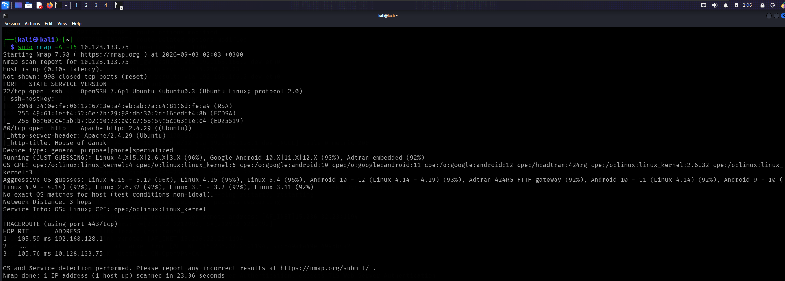

# 01 — Reconnaissance

## Overview

The reconnaissance phase focused on identifying live hosts, open ports, running services, and service versions on the target `10.128.133.75`. This was performed with a single aggressive Nmap scan.

## Objectives

- Identify open TCP ports on the target.
- Fingerprint service names and versions.
- Fingerprint the operating system.
- Capture SSH host key fingerprints for later reference.

## Important Terminology

| Term | Definition |
|---|---|
| Port scanning | Probing a host to determine which TCP/UDP ports are open |
| Service/version detection | Identifying the software and version listening on an open port |
| OS fingerprinting | Inferring the target's operating system from network stack behavior |
| Traceroute | Mapping the network path (hops) to a target host |

## Concepts Explained

An aggressive Nmap scan (`-A`) combines OS detection, version detection, script scanning, and traceroute into a single scan. This trades scan time and "noisiness" for a much richer picture of the target in one pass — useful in a lab context where stealth is not a concern.

## Commands and Syntax

```bash
sudo nmap -A -T5 10.128.133.75
```

## Command Breakdown

| Flag | Purpose |
|---|---|
| `-A` | Enables OS detection, version detection, script scanning, and traceroute |
| `-T5` | Sets timing template to "Insane" (fastest, least stealthy) |
| `10.128.133.75` | Target IP address |

> [!NOTE]
> `-T5` is appropriate for a local/lab network where speed matters more than stealth. On a real assessment against a production network, a slower timing template (`-T2`/`-T3`) is usually preferred to avoid overwhelming the target or tripping IDS/IPS alarms.

## Examples

**Command executed:**

```bash
sudo nmap -A -T5 10.128.133.75
```

**Observed terminal output:**

```text
Starting Nmap 7.98 ( https://nmap.org ) at 2026-09-03 02:03 +0300
Nmap scan report for 10.128.133.75
Host is up (0.10s latency).
Not shown: 998 closed tcp ports (reset)
PORT   STATE SERVICE VERSION
22/tcp open  ssh     OpenSSH 7.6p1 Ubuntu 4ubuntu0.3 (Ubuntu Linux; protocol 2.0)
| ssh-hostkey:
|   2048 34:0e:fe:06:12:67:3e:a4:eb:ab:7a:c4:81:6d:fe:a9 (RSA)
|   256 49:61:1e:f4:52:6e:7b:29:98:db:30:2d:16:ed:f4:8b (ECDSA)
|_  256 b8:60:c4:5b:b7:b2:d0:23:a0:c7:56:59:5c:63:1e:c4 (ED25519)
80/tcp open  http    Apache httpd 2.4.29 ((Ubuntu))
|_http-server-header: Apache/2.4.29 (Ubuntu)
|_http-title: House of danak
Device type: general purpose|phone|specialized
Running (JUST GUESSING): Linux 4.X|5.X|2.6.X|3.X (96%), Google Android 10.X|11.X|12.X (93%), Adtran embedded (92%)
OS CPE: cpe:/o:linux:linux_kernel:4 cpe:/o:linux:linux_kernel:5 cpe:/o:google:android:10 cpe:/o:google:android:11 cpe:/o:google:android:12 cpe:/h:adtran:424rg cpe:/o:linux:linux_kernel:2.6.32 cpe:/o:linux:linux_kernel:3
Aggressive OS guesses: Linux 4.15 - 5.19 (96%), Linux 4.15 (95%), Linux 5.4 (95%), Android 10 - 12 (Linux 4.14 - 4.19) (93%), Adtran 424RG FTTH gateway (92%), Android 10 - 11 (Linux 4.14) (92%), Android 9 - 10 (Linux 4.9 - 4.14) (92%), Linux 2.6.32 (92%), Linux 3.1 - 3.2 (92%), Linux 3.11 (92%)
No exact OS matches for host (test conditions non-ideal).
Network Distance: 3 hops
Service Info: OS: Linux; CPE: cpe:/o:linux:linux_kernel

TRACEROUTE (using port 443/tcp)
HOP RTT      ADDRESS
1   105.59 ms 192.168.128.1
2   ...
3   105.76 ms 10.128.133.75

OS and Service detection performed. Please report any incorrect results at https://nmap.org/submit/ .
Nmap done: 1 IP address (1 host up) scanned in 23.36 seconds
```

### Rationale

A full `-A -T5` scan was chosen as the first command against the target to get service names, versions, and OS guesses in a single pass, minimizing the number of scans needed before moving to enumeration.

## Screenshots



## Observations

- Only two TCP ports open: **22 (SSH)** and **80 (HTTP)**.
- SSH is OpenSSH 7.6p1 on Ubuntu — consistent with **Ubuntu 18.04**.
- Apache 2.4.29 on port 80, HTTP title returned as **"House of danak"** — this became the starting point for web enumeration (see [`docs/03-Web`](../03-Web/README.md)).
- OS guesses were inconclusive/low-confidence ("test conditions non-ideal"), but the SSH banner independently confirms an Ubuntu Linux host.
- Three network hops to the target, consistent with a routed lab/VPN environment.

## Common Mistakes

- Relying solely on Nmap's OS-guess percentages without cross-referencing service banners (e.g., the SSH banner here is a much stronger OS indicator than the aggressive OS guess table).
- Skipping a full port range scan (`-p-`) and assuming only the "Not shown: 998 closed" ports matter — always confirm no additional high ports are open before moving on, especially outside a lab context.
- Using `-T5` reflexively against real-world targets, where it can cause dropped packets, false negatives, or trigger defensive alerting.

## Notes

Only a single scan was performed and captured in these notes. No UDP scan (`-sU`) or full-range TCP scan (`-p-`) output was recorded for this engagement.

## Additional Context

> [!NOTE]
> The following is supplementary background, not something directly observed in this lab.

Nmap's OS fingerprinting relies on subtle differences in how operating systems implement the TCP/IP stack (e.g., initial TTL, window size, TCP options ordering). On virtualized/lab targets these signals can be less reliable, which is why Nmap explicitly flagged "No exact OS matches for host (test conditions non-ideal)" in this scan.

## References

- [Nmap Official Documentation](https://nmap.org/book/man.html)

## Key Takeaways

- A single `-A -T5` scan efficiently surfaced both open services and enough metadata (HTTP title, SSH banner) to plan the next enumeration steps.
- The HTTP title ("House of danak") was the pivot point into web-based enumeration.
- Always treat OS-guess confidence percentages as a hint, not a fact — corroborate with service banners where possible.
