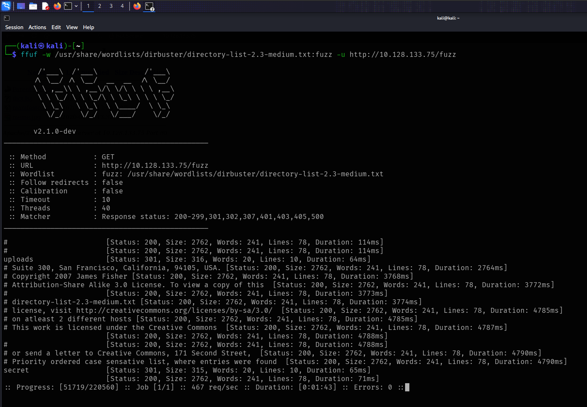

# 02 — Enumeration

## Overview

With HTTP (port 80) identified as the only meaningful attack surface alongside SSH, enumeration focused on discovering hidden directories and files on the web server using `ffuf`.

## Objectives

- Discover directories and files not linked from the visible web application.
- Identify any exposed files that could reveal credentials, configuration, or sensitive data.

## Important Terminology

| Term | Definition |
|---|---|
| Fuzzing | Automatically sending many crafted requests (from a wordlist) to discover valid endpoints |
| Directory brute-forcing | A form of fuzzing specifically targeting directory/file paths |
| Response status matcher | A filter that only reports results matching specific HTTP status codes |
| Wordlist | A list of candidate strings (directory/file names) used to drive fuzzing |

## Concepts Explained

`ffuf` (Fuzz Faster U Fool) replaces a placeholder (`FUZZ`) in a target URL with each entry from a wordlist and reports the HTTP response for each attempt. By filtering on response status codes, an operator can quickly separate "real" discovered paths from generic 404 responses.

## Commands and Syntax

```bash
ffuf -w /usr/share/wordlists/dirbuster/directory-list-2.3-medium.txt:fuzz -u http://10.128.133.75/fuzz
```

## Command Breakdown

| Argument | Purpose |
|---|---|
| `-w <wordlist>:fuzz` | Loads the wordlist and binds it to the keyword `fuzz` |
| `-u http://10.128.133.75/fuzz` | Target URL, with `fuzz` marking the injection point |

The tool's own default configuration for this run also included:

| Setting | Value |
|---|---|
| Method | GET |
| Follow redirects | false |
| Calibration | false |
| Timeout | 10 |
| Threads | 40 |
| Matcher | Response status: `200-299,301,302,307,401,403,405,500` |

## Examples

**Command executed:**

```bash
ffuf -w /usr/share/wordlists/dirbuster/directory-list-2.3-medium.txt:fuzz -u http://10.128.133.75/fuzz
```

**Observed terminal output (relevant lines):**

```text
uploads                 [Status: 301, Size: 316, Words: 20, Lines: 10, Duration: 64ms]
secret                  [Status: 301, Size: 315, Words: 20, Lines: 10, Duration: 65ms]
:: Progress: [51719/220560] :: Job [1/1] :: 467 req/sec :: Duration: [0:01:43] :: Errors: 0 ::
```

### Rationale

`ffuf` was run against the web root to discover any directories not linked from the visible site navigation. Two `301` (redirect — typically indicating a valid directory without a trailing slash) responses stood out: `uploads` and `secret`.

## Screenshots



## Observations

- `/uploads` and `/secret` both returned `301` status codes, indicating they exist as directories on the server.
- Both directories had **directory listing enabled** (Apache's default `Options +Indexes` behavior), which meant their contents could be browsed directly instead of needing further fuzzing. See:
  - [`docs/05-Credentials`](../05-Credentials/README.md) for what was found inside `/uploads` and `/secret`.

## Common Mistakes

- Not adjusting the `-fc` (filter code) or matcher settings when a target returns a "soft 404" (a 200 response for non-existent pages) — this run relied on the tool's default status matcher rather than calibration, so it's worth double-checking results manually when in doubt.
- Stopping enumeration after the first interesting hit — both `/uploads` and `/secret` needed to be explored, not just one.
- Forgetting that a `301` on a directory without a trailing slash simply means "redirect to `/path/`" — the real content lives one request away.

## Notes

The wordlist used was the built-in Kali `dirbuster/directory-list-2.3-medium.txt`, a common medium-sized general-purpose directory list.

## Additional Context

> [!NOTE]
> Supplementary information, not directly observed in this specific run.

`ffuf` is commonly paired with `-e` (extensions, e.g., `-e .php,.txt,.bak`) or recursion (`-recursion`) to dig deeper once an initial directory is found. Neither flag was used in this particular scan, but they are natural next steps for follow-on enumeration against a similar target.

## References

- [ffuf GitHub Repository](https://github.com/ffuf/ffuf)

## Key Takeaways

- Directory brute-forcing surfaced two non-linked directories (`/uploads`, `/secret`) that were not discoverable from the visible site navigation.
- Both directories had listing enabled, turning a fuzzing win into direct, browsable access to file contents.
