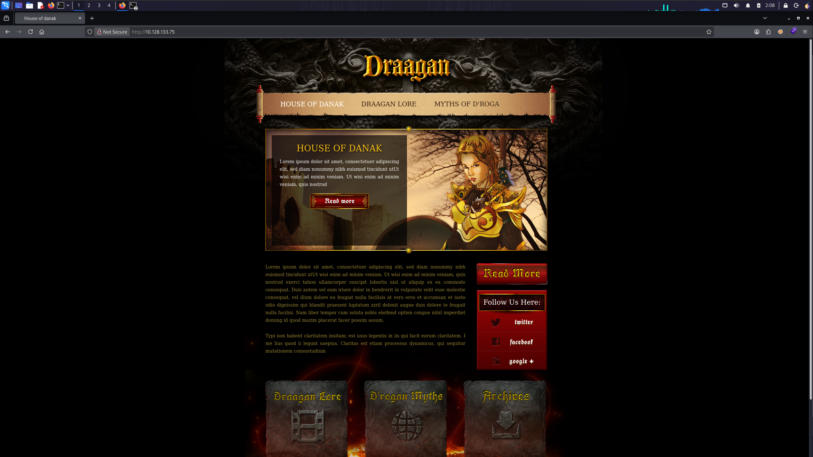
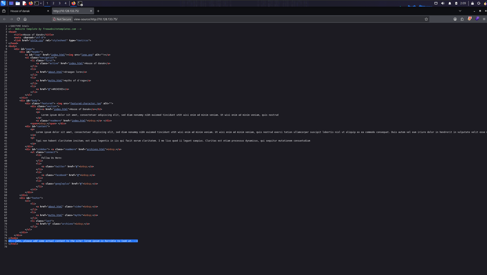

# 03 — Web Application Analysis

## Overview

The web application on port 80 ("House of danak") was reviewed manually in the browser, both as a rendered page and via its raw HTML source, to look for information that automated tools might miss — such as developer comments.

## Objectives

- Understand what the web application is and what it exposes.
- Review the raw page source for hints, comments, or metadata.
- Identify any usernames, filenames, or paths referenced in the source.

## Important Terminology

| Term | Definition |
|---|---|
| `view-source:` | A browser URI scheme that displays the raw HTML of a page instead of rendering it |
| HTML comment | Text wrapped in `<!-- -->`, invisible in the rendered page but visible in the source |
| Template site | A pre-built website theme reused across many projects, often with generic placeholder content |

## Concepts Explained

Reviewing page source is a low-effort, high-value step in web enumeration. Developers frequently leave comments, TODOs, or debug notes in HTML/CSS/JS that are never meant to reach a live audience but remain visible to anyone who views the source.

## Commands and Syntax

No terminal commands were used for this stage. Enumeration was performed directly in the browser using the `view-source:` URI scheme:

```text
view-source:http://10.128.133.75/
```

## Command Breakdown

| Action | How | Purpose |
|---|---|---|
| View rendered page | Navigate to `http://10.128.133.75` | Understand the application's visible content and navigation |
| View raw HTML source | Navigate to `view-source:http://10.128.133.75/` | Inspect markup and comments not visible in the rendered page |

## Examples

The rendered homepage displayed a "Draagan" fantasy-themed template with navigation links for **House of Danak**, **Draagan Lore**, and **Myths of D'roga**, along with Lorem Ipsum placeholder text and social links (Twitter/Facebook/Google+).

Viewing the raw source (`view-source:http://10.128.133.75/`) revealed the underlying HTML structure, including a link to `style.css`, an `index.html` navigation structure referencing `about.html`, `myths.html`, and a placeholder `#` link for "ARCHIVES" — and, critically, an HTML comment at the very end of the file:

```html
<!-- john, please add some actual content to the site! lorem ipsum is horrible to look at. -->
```

### Rationale

The page title from the Nmap scan ("House of danak") was the only lead from recon, so the web app was opened directly to understand what it was and whether it held any further clues.

## Screenshots





## Observations

- The site is a reused HTML/CSS template (comment in source: `<!-- Website template by freewebsitetemplates.com -->`) with fantasy "Draagan" branding, populated with Lorem Ipsum placeholder text.
- A developer left an HTML comment at the bottom of the page directly addressing a person named **"john"**, asking them to replace the placeholder content.
- This is the **first and only indicator of a username** (`john`) found during the assessment, and it became directly relevant later — see [`docs/06-Initial-Access`](../06-Initial-Access/README.md), where `john` turned out to be a valid system account.

## Common Mistakes

- Skipping manual source review because a page "looks like just a template" — the most useful finding on this page (the username `john`) was only visible in the raw HTML comment, not the rendered page.
- Assuming Lorem Ipsum content means a page has "nothing of value" — metadata and comments around placeholder content can still be significant.

## Notes

No additional pages (`about.html`, `myths.html`) were captured in these notes beyond the homepage and its source.

## Additional Context

> [!NOTE]
> Supplementary background, not directly observed in this lab.

Leaving developer/internal comments in production HTML is a common and low-severity but real information-disclosure issue. It's good practice, from a defensive standpoint, to strip HTML comments during a build/deploy process for anything user-facing.

## References

- [MDN Web Docs — HTML Comments](https://developer.mozilla.org/en-US/docs/Web/HTML/Comments)

## Key Takeaways

- Manual review of page source is a fast, low-cost enumeration step that automated scanners can miss the *context* of, even if they flag the comment's existence.
- A single HTML comment revealed a valid username (`john`) that was later confirmed as a real account on the target system.
