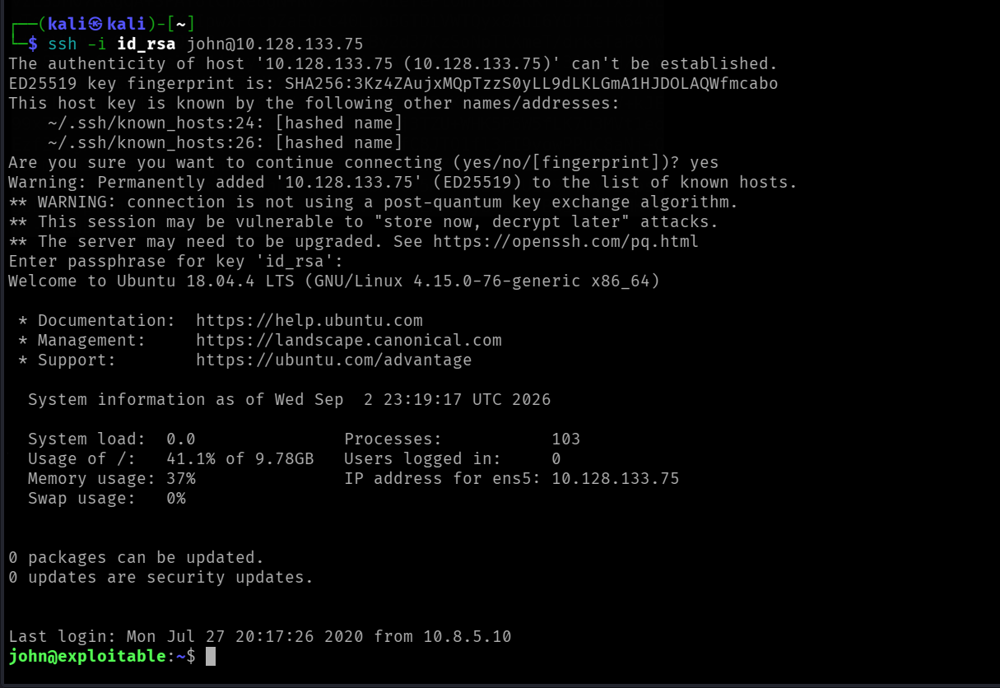
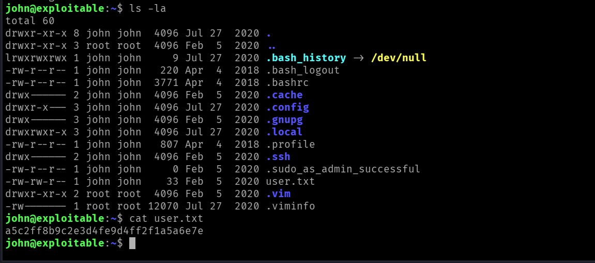

# 06 — Initial Access

## Overview

With a cracked private key passphrase and a username (`john`, discovered in the page source — see [`docs/03-Web`](../03-Web/README.md)) in hand, the next step was straightforward: authenticate to the target's SSH service.

## Objectives

- Authenticate to the target over SSH using the recovered private key and passphrase.
- Confirm the resulting shell access and gather the user-level flag.

## Important Terminology

| Term | Definition |
|---|---|
| SSH key-based authentication | Authenticating to SSH using a public/private key pair instead of (or in addition to) a password |
| Passphrase | A secret used to decrypt an encrypted private key, distinct from the account's login password |
| Flag | In a lab/CTF context, a marker file (e.g., `user.txt`) proving a specific level of access was achieved |

## Concepts Explained

Once both the username and a usable (decrypted) private key are available, SSH key-based authentication is attempted directly. If the server accepts that key for the given user, a shell is granted without needing the account's actual login password.

## Commands and Syntax

```bash
ssh -i id_rsa john@10.128.133.75
```

## Command Breakdown

| Argument | Purpose |
|---|---|
| `-i id_rsa` | Specifies the private key file to use for authentication |
| `john@10.128.133.75` | Target username and host |

## Examples

**Command executed:**

```bash
ssh -i id_rsa john@10.128.133.75
```

**Observed terminal output:**

```text
The authenticity of host '10.128.133.75 (10.128.133.75)' can't be established.
ED25519 key fingerprint is: SHA256:3Kz4ZAujxMQpTzzS0yLL9dLKLGmA1HJDOLAQWfmcabo
This host key is known by the following other names/addresses:
    ~/.ssh/known_hosts:24: [hashed name]
    ~/.ssh/known_hosts:26: [hashed name]
Are you sure you want to continue connecting (yes/no/[fingerprint])? yes
Warning: Permanently added '10.128.133.75' (ED25519) to the list of known hosts.
Enter passphrase for key 'id_rsa':
Welcome to Ubuntu 18.04.4 LTS (GNU/Linux 4.15.0-76-generic x86_64)

  System load:  0.0                 Processes:            103
  Usage of /:   41.1% of 9.78GB     Users logged in:      0
  Memory usage: 37%                 IP address for ens5:  10.128.133.75
  Swap usage:   0%

Last login: Mon Jul 27 20:17:26 2020 from 10.8.5.10
john@exploitable:~$
```

**Confirming access and reading the user flag:**

```bash
ls -la
cat user.txt
```

```text
total 60
drwxr-xr-x 8 john john  4096 Jul 27  2020 .
drwxr-xr-x 3 root root  4096 Feb  5  2020 ..
lrwxrwxrwx 1 john john     9 Jul 27  2020 .bash_history -> /dev/null
-rw-r--r-- 1 john john   220 Apr  4  2018 .bash_logout
-rw-r--r-- 1 john john  3771 Apr  4  2018 .bashrc
drwx------ 2 john john  4096 Feb  5  2020 .cache
drwxr-x--- 3 john john  4096 Jul 27  2020 .config
drwx------ 2 john john  4096 Feb  5  2020 .gnupg
drwxrwxr-x 3 john john  4096 Jul 27  2020 .local
-rw-r--r-- 1 john john   807 Apr  4  2018 .profile
drwx------ 2 john john  4096 Feb  5  2020 .ssh
-rw-r--r-- 1 john john     0 Feb  5  2020 .sudo_as_admin_successful
-rw-rw-r-- 1 john john    33 Feb  5  2020 user.txt
drwxr-xr-x 2 root root  4096 Feb  5  2020 .vim
-rw------- 1 root root 12070 Jul 27  2020 .viminfo
john@exploitable:~$ cat user.txt
a5c2ff8b9c2e3d4fe9d4ff2f1a5a6e7e
```

### Rationale

`ssh` with `-i` targeting the recovered key was the direct, logical continuation of the credential discovery phase — the username `john` (from the HTML comment) and the decrypted key/passphrase (`letmein`) together provided everything needed for authentication.

## Screenshots





## Observations

- The target host key had **not** previously been trusted by this attacking machine for this specific IP (`10.128.133.75`), so SSH prompted for fingerprint confirmation on first connect — this is standard SSH host-key-verification behavior, not indicative of anything unusual about the target.
- SSH warned that the connection is **not using a post-quantum key exchange algorithm** — a general, forward-looking SSH client notice, not specific to this target's configuration.
- Authentication succeeded as **`john`**, confirming the username found in the page source comment was correct.
- The home directory contained a `user.txt` flag, readable immediately after login, containing the value `a5c2ff8b9c2e3d4fe9d4ff2f1a5a6e7e`.
- `.bash_history` was symlinked to `/dev/null`, meaning no historical command record was retrievable from that file for further intel.
- `john` belonging to group `lxd` (confirmed later — see [`docs/07-Privilege-Escalation`](../07-Privilege-Escalation/README.md)) was the critical detail for the next phase.

## Common Mistakes

- Discarding an encrypted key as "unusable" instead of attempting to crack its passphrase offline first.
- Not double-checking which username to target — without the HTML comment discovered during web review, the correct account (`john`) may not have been obvious.
- Blindly trusting SSH host key prompts without any verification in a real (non-lab) engagement — always have an out-of-band way to confirm host key fingerprints when authenticity actually matters.

## Notes

The `.bash_history -> /dev/null` symlink is a deliberate hardening/anti-forensics measure sometimes used to prevent command history from persisting to disk.

## Additional Context

> [!NOTE]
> Supplementary background, not directly observed in this lab.

SSH's "store now, decrypt later" warning refers to the theoretical future risk that an adversary could record encrypted traffic today and decrypt it later once sufficiently powerful quantum computers exist, if the key exchange algorithm used isn't quantum-resistant. This is a forward-looking SSH client advisory unrelated to the actual exploitation path used in this engagement.

## References

- [OpenSSH Documentation](https://www.openssh.com/manual.html)

## Key Takeaways

- The combination of an exposed username (page-source comment) and a crackable encrypted private key (exposed via directory listing) provided a full authentication chain to the target.
- Initial access was achieved as a low-privileged user (`john`), setting up the privilege escalation phase.
